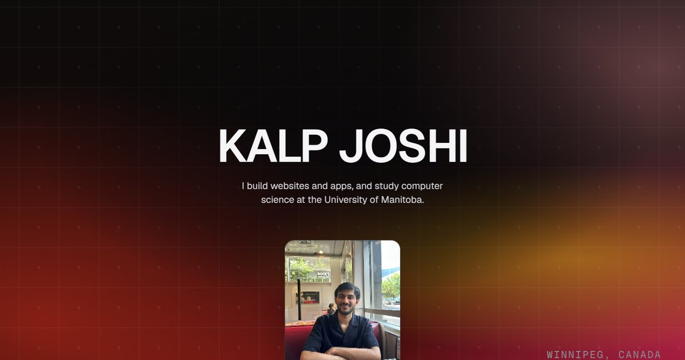

# kalpkj.github.io

My personal site: who I am, what I've built, and what I do away from the screen.

**Live:** https://kalpkj.github.io



## What's on it

- **Projects**: Buildora, KVSCHE, Happy Brides and ExerGen. On a wide screen, hovering a project shows its screenshot and links; on a phone they stack. Below them, Jutsu, Ask the Gita, Sundarkand and Atomix are listed as other projects, with links only.
- **Experience**: Buildora, the client work and my degree, with my résumé as a PDF.
- **Off the clock**: my own paintings in a 3D carousel, the anime I've watched, and a chess puzzle you can play on the board.
- **Contact**: LinkedIn and GitHub.

## How it's built

- Next.js 16 (App Router) with React 19 and TypeScript, exported as static HTML for GitHub Pages.
- Plain CSS with design tokens in `app/globals.css`; no CSS framework.
- Motion with Framer Motion, GSAP for the menu marquee, and Lenis for smooth scrolling. With reduced motion turned on, the drifting gradients, parallax, smooth scrolling and portrait flight switch off. Content stays visible if JavaScript doesn't run.
- The portrait moves from the hero into the About section as you scroll, flipping from colour to black and white on the way. One `requestAnimationFrame` loop reads both resting places every frame, so it stays aligned at any window size.
- All copy and image paths live in `app/content.ts`.

## Run it

```bash
npm install
npm run dev        # http://localhost:3000
npm run build      # static site in out/
npm run typecheck
```

Every push to `main` is type-checked, built and deployed by `.github/workflows/deploy.yml`.

## Licence

The code is MIT licensed (see `LICENSE`). The photos of me, my résumé and the artwork in `public/art` are mine, all rights reserved; please don't reuse them.
